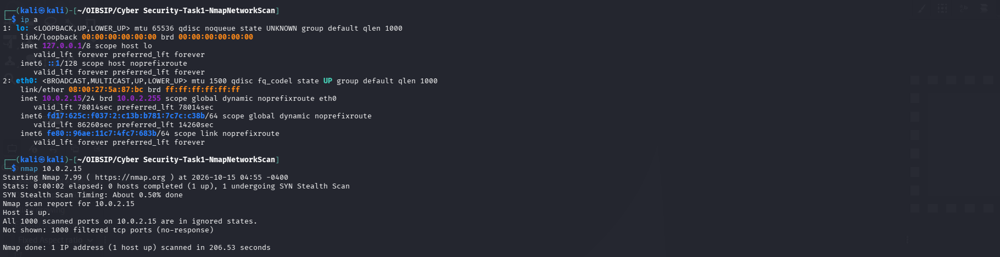
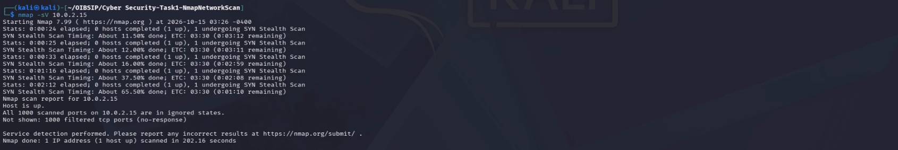
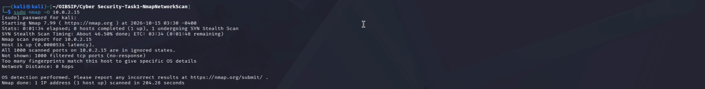
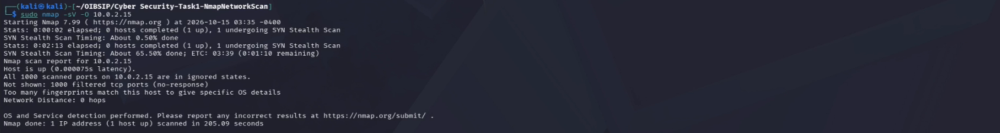

# Task 1: Basic Network Scanning with Nmap

## Overview
- **What Nmap is:** Network Mapper (Nmap) is an open-source tool used for network exploration, administration, and security auditing.
- **Why Network Scanning Matters:** It helps administrators discover hosts, services, and operating systems on a network, identifying potential vulnerabilities before malicious actors can exploit them.
- **Ethical Use Guidelines:** Network scanning should only be performed on networks and machines that you explicitly own or have written permission to test (in this case, scanned on my local Kali Linux VM)[cite: 3].

## Open Ports & Security Analysis
*(For every open port found during your scan, document it here like this example):*
- **Port 22/tcp (SSH):** Secure Shell service running for remote login. **Security Risk:** Low risk if properly configured with key-based authentication, but vulnerable to brute-force attacks if weak passwords are used.

## Screenshots
- **Basic Scan:** 
- **Version Detection (-sV):** 
- **OS Detection (-O):** 
- **Combined Scan (-sV -O):** 
