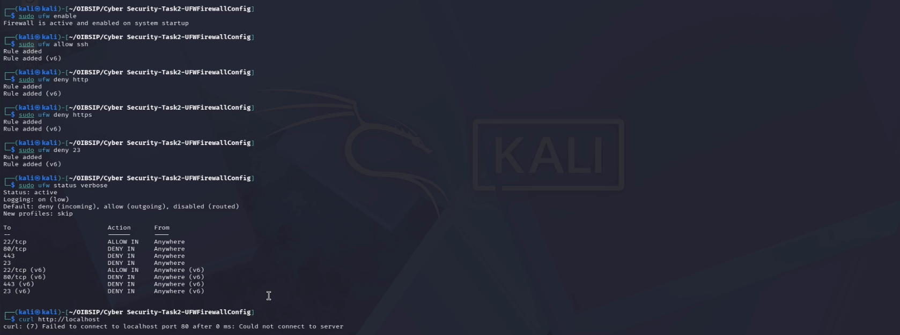

# Task 2: Basic Firewall Configuration with UFW

## Overview
- **What a Firewall Does:** A firewall monitors and controls incoming and outgoing network traffic based on predetermined security rules, acting as a barrier between a trusted internal network and untrusted external networks.

## Firewall Rules Implemented
1. `sudo ufw enable`: Enables the firewall on the system[cite: 4].
2. `sudo ufw allow ssh`: Allows incoming SSH (Port 22) connections for remote administration[cite: 4].
3. `sudo ufw deny http`: Blocks incoming HTTP (Port 80) web traffic[cite: 4].
4. `sudo ufw allow https`: Allows secure HTTPS web traffic[cite: 4].
5. `sudo ufw deny 23`: Explicitly blocks Telnet (Port 23) due to its insecure, unencrypted nature[cite: 4].

## Verification & Testing
- **Status Output:** 
- **Denied Traffic Test:** When testing `curl http://localhost` after denying port 80, the connection timed out or was refused, confirming that the rule successfully blocks unauthorized web traffic[cite: 4].

